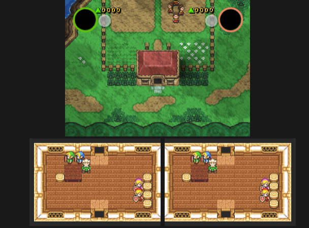
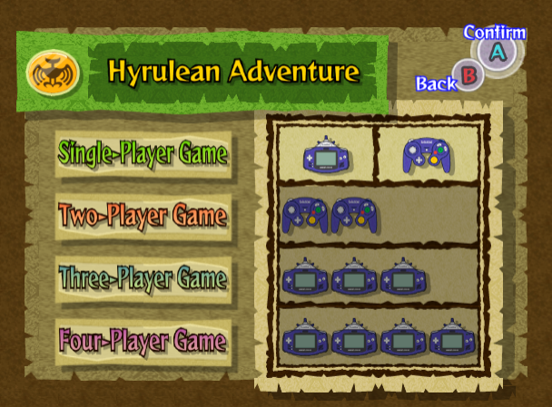
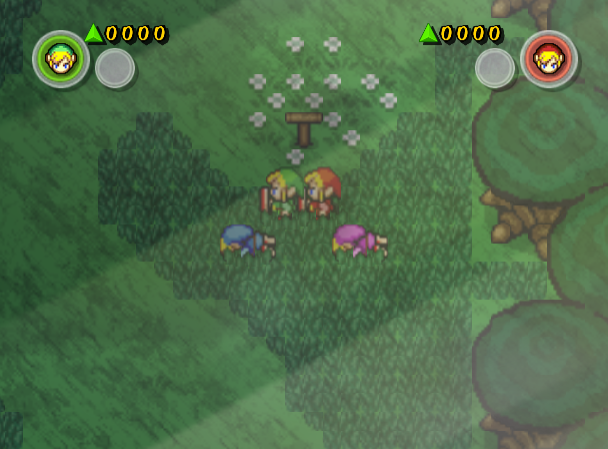
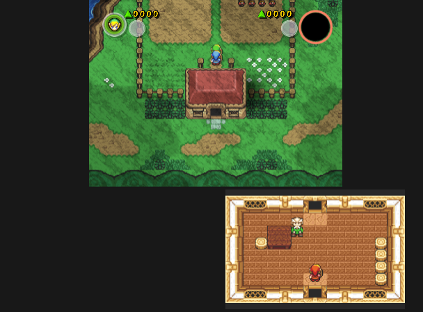
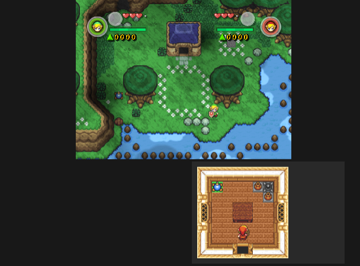
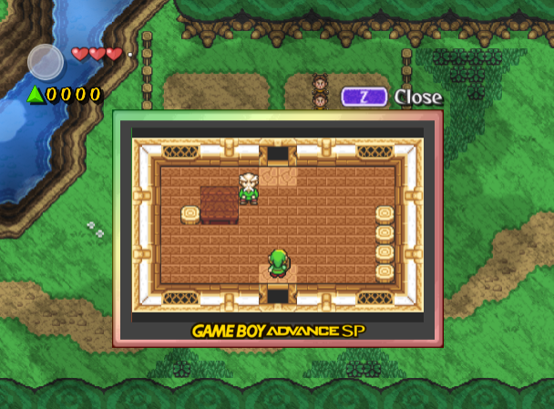

# Four Swords Adventures: Two GameCube Controllers Mod



A mod for **The Legend of Zelda: Four Swords Adventures** (GameCube, USA, `G4SE01`, revision 0). It lets two people play the multiplayer modes with two regular GameCube controllers. The original game requires every multiplayer player to have a Game Boy Advance and a GBA link cable.

> **No game files are included.** You need your own copy of the game. This repo only contains the tools and patches that modify it.

## What it does

### 1. Two-player with two GameCube controllers
- Controller port 1 is Player 1 and controller port 2 is Player 2. No Game Boy Advance or link cables needed.
- Each player controls their own Links on their own controller.
- At the start of a level, walk next to your sleeping partner Link and press **Y** to gather it.

### 2. Split screen instead of GBA screens
In the original game, when a player goes into a house or cave, their view moves to their Game Boy Advance screen. In this mod it goes to the TV instead:
- **Top (~60%)**: the shared world view, shrunk and centered.
- **Bottom left**: Player 1's private view (inside houses, caves, etc.).
- **Bottom right**: Player 2's private view.

The top view only shrinks while someone is inside a private area. When both players are back outside, it returns to full screen.

### 3. Shadow Battle works with two controllers
Shadow Battle (the versus mode) loads and plays with two GameCube controllers. The original game crashed here: when a GameCube controller is in a Shadow Battle it switches to an unused, controller-only stage table (`map500_ctrl.csv`) whose entries refer to arena layouts 12–23, while the disc only has layouts 00–09. The mod always uses the normal table (`map500.csv`), the one the game uses with Game Boy Advances, so stage selection works as in the original.

### 4. New menu option
On the player-count screens for both **Hyrulean Adventure** and **Shadow Battle**, the **Two-Player** row now shows two GameCube controllers instead of two Game Boy Advances.

### 5. Dialog on the TV
In the original multiplayer, text spoken inside houses and caves (including Yes/No choices) was shown on the player's Game Boy Advance. In this mod it appears in a normal text box on the TV and advances with **A**.

### 6. Even out the Links
In multiplayer one player can end up holding three Links while the other has one. Either player can **hold L and R fully for 3 seconds** to hand one Link back, so each player has two again.

### 7. Single player is unchanged
Single-player plays exactly like the original, including its own window on the TV when you go into houses. All new behavior only switches on in the two-controller mode.

## Controls (same for both players)

Each player's GameCube controller replaces their Game Boy Advance. The buttons use the game's own GameCube controller layout (the one single-player uses), so nothing was remapped and every GBA action has a button. This applies in both Hyrulean Adventure and Shadow Battle.

| Action | Button |
|---|---|
| Move | Control Stick |
| Sword (hold for spin attack) | B |
| Use item / talk | A |
| Lift / throw | R |
| Gather Links / formation menu | Y or L |
| Quick formation | C-Stick |
| Split off / switch Links | X or D-Pad |
| Pause | START |
| Even out the Links (3 + 1 → 2 + 2) | Hold L + R fully for 3 seconds |

## How it works (short version)

- **Input:** the game already had code for a GameCube controller player. It was only allowed for single-player. Small patches let the multiplayer setup accept a controller in each port and register each player as a "GameCube controller" player. A check that decides whether a player "has a GBA" now also accepts a controller, but only in the two-controller mode. That way single-player keeps its original behavior.
- **Display:** the game already draws each player's private view as a window on the TV (that's how single-player shows houses). The mod uses that window for both players and moves the windows to the bottom of the screen. It also scales the main 3D view (viewport and scissor) down into the top area whenever a window is open.
- **Shadow Battle:** always uses the normal (GBA) stage table; the unused controller-only table is skipped.
- **Link rebalance:** while L and R are both fully pressed, their normal actions are held back; after 3 seconds, one follower of the player with three Links is handed to the other player.
- **Triggers:** the game remembers whether L/R is "pressed most of the way" per controller instead of sharing one value between both controllers.
- **Dialog:** every "send this text to the player's GBA" call in the game's text system (normal text and Yes/No choices) is redirected, in two-controller mode only, to the matching TV text-box routine.
- **Menus:** edits the two player-count layout files inside `entry.arc` (`adv_n_player.blo` and `bat_n_player.blo`) so their Two-Player rows use the GameCube controller picture. The Shadow Battle layout didn't reference that picture, so it is added to its texture list.
- **Where the new code lives:** about 6 KB of space for new code is added as an extra section of the game's executable (`main.dol`) at `0x80555F80`, right after the game's own memory. The game's heap start is raised so nothing overwrites it. The low-memory area some loaders and cheat engines use is left alone.

## Building your own ISO

Requirements: **Python 3** (no extra packages) and **your own clean USA ISO** (`G4SE01`, SHA-1 `4bd926835dfbeaae72d01abe5fb581b527154a30`).

```
python3 build.py "Legend of Zelda, The - Four Swords Adventures (USA).iso" "Zelda FSA 2GC.iso"
```

That's it. The script:
1. Checks that your ISO is the expected clean USA copy. Your original is only read, never changed.
2. Builds the patches into the game's executable (`build/bake_dol.py`, using `patches/G4SE01_2gc_patches.ini`).
3. Patches the two player-count menus (`menu/patch_menu.py`).
4. Writes the new ISO (`tools/copy_used.py`, then `tools/build_iso.py`). Only `main.dol` and `entry.arc` change. They are written into unused space on the disc, and all other game files stay byte-for-byte identical.
5. Prints the SHA-1 of the result. The value listed in `build.py` (`OUT_SHA1`) is from an older build, so a "differs" warning is expected until it is updated.

The output is a standard full-size GameCube disc image (1,459,978,240 bytes) with the original game ID `G4SE01`. If the build is interrupted, run the same command again and it resumes.

### Trying it in Dolphin without building
`patches/G4SE01_2gc_patches.ini` is a Dolphin game-patch file. Copy it to Dolphin's `GameSettings` folder as `G4SE01.ini` to run the gameplay and split-screen changes on an unmodified ISO. The menu icons need the built ISO. Don't use this patch file together with the built ISO.

### Repository layout
| Path | What it is |
|---|---|
| `build.py` | One-command build |
| `patches/G4SE01_2gc_patches.ini` | All code patches (Dolphin patch format) |
| `build/bake_dol.py` | Builds the patches into `main.dol` and adds the new code section |
| `menu/patch_menu.py` | Changes the Two-Player icons on both player-count menus (plus `rarc.py` and `yaz0enc.py` archive helpers) |
| `tools/gcfs.py` | Reads the GameCube disc file system |
| `tools/copy_used.py`, `tools/build_iso.py` | Write the patched disc image |
| `docs/img/` | Screenshots |

## Screenshots

| | |
|---|---|
|  |  |
| Two-Player menu row with GameCube controllers | Two-player game start, one HUD per player |
|  |  |
| Player 2 inside a house: top view shrinks, P2 panel bottom-right | Shadow Battle with Player 2's panel |
|  | |
| Single-player unchanged (original house window) | |

Screenshots are from the Dolphin emulator.

## Playing on a real GameCube

Copy the ISO to an SD card and launch it with **Swiss** (tested target: Swiss v0.6 with an SD2SP2 adapter). Plug controllers into ports 1 and 2. Choose **Hyrulean Adventure → Two-Player Game**, or **Shadow Battle**.

## Changelog
- **Link rebalance and triggers:** hold L + R for 3 seconds to even out the Links; L/R analog thresholds are now tracked per controller.
- **Game Boy SP window allowed:** the earlier patch that hid this window was removed, so the game shows it whenever it wants to.
- **Dialog:** indoor dialog and Yes/No choices now show on the TV instead of freezing while waiting for a Game Boy Advance.
- **Shadow Battle menu:** the Two-Player row on the Shadow Battle player-count screen also shows GameCube controllers.
- **First ISO build:** all patches built into the game's executable, a one-command build script, and the Hyrulean Adventure Two-Player menu icons.
- **Split screen:** a three-region layout (shared view on top, one panel per player at the bottom), plus the Shadow Battle crash fix.
- **Two-controller play:** two GameCube controllers drive two players, and players can enter houses and caves.

## Disclaimer
Fan project for personal use. *The Legend of Zelda* is a trademark of Nintendo. Not affiliated with or endorsed by Nintendo. Do not distribute game files or ISOs.
